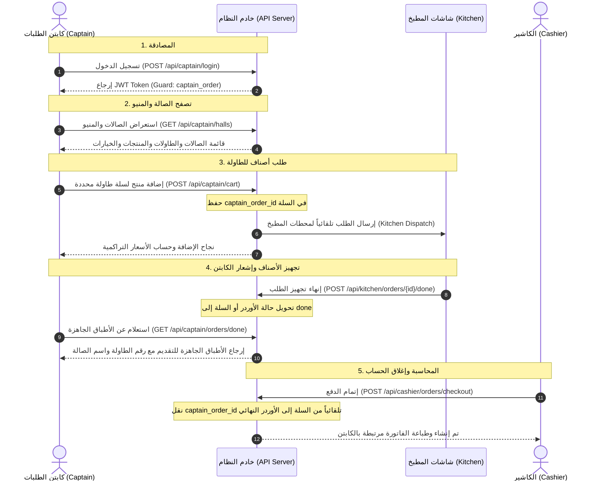

# 📋 توثيق موديول كابتن الطلبات (Captain Order Module API Documentation)

دليل تقني شامل وتفصيلي لكافة واجهات برمجة التطبيقات (APIs) الخاصة بموديول كابتن الطلبات (`captain_order`) في نظام المطعم، متضمناً دورة العمل، الـ Headers، الـ Query Parameters، الـ Request Body، نماذج الردود (Responses)، وحالات الخطأ مع شرح كامل.

---

## 📌 الفهرس (Table of Contents)
1. [دورة العمل ومخطط النظام (Workflow & Sequence)](#1-دورة-العمل-ومخطط-النظام-workflow--sequence)
2. [الـ Headers العامة للمصادقة واللغة (Global Headers)](#2-الـ-headers-العامة-للمصادقة-واللغة-global-headers)
3. [المصادقة وتسجيل الدخول (Authentication APIs)](#3-المصادقة-وتسجيل-الدخول-authentication-apis)
   - [تسجيل دخول الكابتن (POST /api/captain/login)](#31-تسجيل-دخول-الكابتن-post-apicaptainlogin)
   - [تسجيل الدخول عبر الواجهة العامة (POST /api/auth/login)](#32-تسجيل-الدخول-عبر-الواجهة-العامة-post-apiauthlogin)
   - [الملف الشخصي للكابتن (GET /api/captain/me)](#33-الملف-الشخصي-للكابتن-get-apicaptainme)
   - [تجديد التوكن (POST /api/captain/refresh)](#34-تجديد-التوكن-post-apicaptainrefresh)
   - [تسجيل الخروج (POST /api/captain/logout)](#35-تسجيل-الخروج-post-apicaptainlogout)
4. [استعراض الصالات والمنيو (Home & Catalog APIs)](#4-استعراض-الصالات-والمنيو-home--catalog-apis)
   - [عرض الصالات والطاولات (GET /api/captain/halls)](#41-عرض-الصالات-والطاولات-get-apicaptainhalls)
   - [معلومات طاولة محددة (GET /api/captain/table/{hallTable})](#42-معلومات-طاولة-محددة-get-apicaptaintablehalltable)
   - [الأقسام الرئيسية (GET /api/captain/categories/parents)](#43-الأقسام-الرئيسية-get-apicaptaincategoriesparents)
   - [الأقسام الفرعية (GET /api/captain/categories/sub)](#44-الأقسام-الفرعية-get-apicaptaincategoriessub)
   - [قائمة المنتجات (GET /api/captain/products)](#45-قائمة-المنتجات-get-apicaptainproducts)
   - [تفاصيل منتج مع الخيارات (GET /api/captain/products/{product})](#46-تفاصيل-منتج-مع-الخيارات-get-apicaptainproductsproduct)
   - [قائمة الإضافات (GET /api/captain/addons)](#47-قائمة-الإضافات-get-apicaptainaddons)
5. [سلة طلبات الطاولة لكابتن الأوردر (Captain Table Cart APIs)](#5-سلة-طلبات-الطاولة-لكابتن-الأوردر-captain-table-cart-apis)
   - [عرض عناصر سلة الطاولة (GET /api/captain/cart)](#51-عرض-عناصر-سلة-الطاولة-get-apicaptaincart)
   - [إضافة منتج للسلة وإرساله للمطبخ (POST /api/captain/cart)](#52-إضافة-منتج-للسلة-وإرساله-للمطبخ-post-apicaptaincart)
   - [عرض تفاصيل عنصر بالسلة (GET /api/captain/cart/{cart})](#53-عرض-تفاصيل-عنصر-بالسلة-get-apicaptaincartcart)
   - [تعديل عنصر بالسلة (PUT /api/captain/cart/{cart})](#54-تعديل-عنصر-بالسلة-put-apicaptaincartcart)
   - [حذف عنصر من السلة (DELETE /api/captain/cart/{cart})](#55-حذف-عنصر-من-السلة-delete-apicaptaincartcart)
   - [تفريغ سلة الطاولة (DELETE /api/captain/cart/clear)](#56-تفريغ-سلة-الطاولة-delete-apicaptaincartclear)
6. [سلة الطاولة العامة وتمرير كود الكابتن (Table Cart with captain_order_id)](#6-سلة-الطاولة-العامة-وتمرير-كود-الكابتن-table-cart-with-captain_order_id)
   - [إضافة للسلة مع captain_order_id (POST /api/table/cart)](#61-إضافة-للسلة-مع-captain_order_id-post-apitablecart)
7. [محاسبة الكاشير وربط كابتن الأوردر (Cashier Checkout with captain_order_id)](#7-محاسبة-الكاشير-وربط-كابتن-الأوردر-cashier-checkout-with-captain_order_id)
   - [إتمام الطلب بالكاشير (POST /api/cashier/orders/checkout)](#71-إتمام-الطلب-بالكاشير-post-apicashierorderscheckout)
8. [متابعة الطلبات المنتهية في المطبخ (Kitchen Done Orders & Serving APIs)](#8-متابعة-الطلبات-المنتهية-في-المطبخ-kitchen-done-orders--serving-apis)
   - [عرض الطلبات المنتهية للكابتن لتقديمها (GET /api/captain/orders/done)](#81-عرض-الطلبات-المنتهية-للكابتن-لتقديمها-get-apicaptainordersdone)
   - [عرض الطلبات المنتهية من واجهة المطبخ (GET /api/kitchen/orders/done)](#82-عرض-الطلبات-المنتهية-من-واجهة-المطبخ-get-apikitchenordersdone)
   - [قائمة طلبات الصالة للكابتن (GET /api/captain/orders)](#83-قائمة-طلبات-الصالة-للكابتن-get-apicaptainorders)
   - [تفاصيل أوردر محدد (GET /api/captain/orders/{order})](#84-تفاصيل-أوردر-محدد-get-apicaptainordersorder)

---

## 1. دورة العمل ومخطط النظام (Workflow & Sequence)



---

## 2. الـ Headers العامة للمصادقة واللغة (Global Headers)

| Header | النوع | القيمة / مثال | الوصف | إلزامي؟ |
|:---|:---|:---|:---|:---|
| `Authorization` | String | `Bearer eyJhbGciOiJIUzI1Ni...` | توكن مصادقة JWT الخاص بالكابتن أو المستخدم | إلزامي في المسارات المحمية |
| `Accept` | String | `application/json` | استقبال استجابات السيرفر بتنسيق JSON | نعم |
| `Content-Type` | String | `application/json` | تنسيق البيانات المرسلة في الـ Body | نعم (في طلبات POST/PUT) |
| `Accept-Language` | String | `ar` أو `en` | لغة المخرجات والنصوص المعربة (الافتراضي: `ar`) | اختياري |

---

## 3. المصادقة وتسجيل الدخول (Authentication APIs)

### 3.1 تسجيل دخول الكابتن (POST /api/captain/login)
المسار المخصص لتسجيل دخول كابتن الطلبات للحصول على توكن الصلاحية.

* **المسار:** `POST /api/captain/login`
* **المصادقة:** لا يتطلب توكن (`Public`).
* **الـ Request Body:**

| الحقل | النوع | إلزامي؟ | الوصف | مثال |
|:---|:---|:---|:---|:---|
| `user_name` | String | إلزامي (إذا لم يرسل name) | اسم المستخدم للكابتن | `"captain_samy"` |
| `name` | String | اختياري | بديل لحقل user_name | `"captain_samy"` |
| `password` | String | إلزامي | كلمة المرور | `"secret123"` |

* **نموذج الطلب (Request):**
```json
{
  "user_name": "captain_samy",
  "password": "secret123"
}
```

* **الاستجابة الناجحة (200 OK):**
```json
{
  "status": true,
  "message": "تم تسجيل الدخول بنجاح",
  "data": {
    "access_token": "eyJhbGciOiJIUzI1NiIsInR5cCI6IkpXVCJ9...",
    "token_type": "Bearer",
    "expires_at": "2026-10-25T23:30:00+03:00",
    "expires_in": 86400,
    "guard": "captain_order",
    "user": {
      "id": 1,
      "name": "سامي كابتن",
      "user_name": "captain_samy",
      "status": true,
      "role": "captain_order",
      "images": [],
      "images_urls": []
    }
  }
}
```

* **حالات الخطأ:**
  * `401 Unauthorized`: بيانات الدخول غير صحيحة (`{"status": false, "message": "بيانات الدخول غير صحيحة (Invalid credentials)."}`).
  * `403 Forbidden`: الحساب معطل من قبل الإدارة (`{"status": false, "message": "الحساب معطل حالياً (Account is inactive)."}`).

---

### 3.2 تسجيل الدخول عبر الواجهة العامة (POST /api/auth/login)
يمكن أيضاً تسجيل الدخول عبر نقطة الدخول الموحدة للنظام بتحديد الـ guard.

* **المسار:** `POST /api/auth/login`
* **الـ Request Body:**
```json
{
  "name": "captain_samy",
  "password": "secret123",
  "guard": "captain_order"
}
```
* **الاستجابة:** نفس بنية الرد الموضحة في النقطة 3.1.

---

### 3.3 الملف الشخصي للكابتن (GET /api/captain/me)
جلب بيانات الكابتن صاحب التوكن الحالي.

* **المسار:** `GET /api/captain/me`
* **الـ Headers:** `Authorization: Bearer {token}`
* **الاستجابة الناجحة (200 OK):**
```json
{
  "status": true,
  "data": {
    "id": 1,
    "name": "سامي كابتن",
    "user_name": "captain_samy",
    "status": true,
    "role": "captain_order"
  }
}
```

---

### 3.4 تجديد التوكن (POST /api/captain/refresh)
تجديد صلاحية الـ JWT Token الحالي قبل انتهائه دون الحاجة لكتابة كلمة المرور.

* **المسار:** `POST /api/captain/refresh`
* **الـ Headers:** `Authorization: Bearer {token}`
* **الاستجابة الناجحة (200 OK):**
```json
{
  "status": true,
  "message": "تم تجديد التوكن بنجاح",
  "data": {
    "access_token": "eyJhbGciOiJIUzI1NiIsInR5cCI...",
    "token_type": "Bearer",
    "expires_at": "2026-10-25T23:45:00+03:00",
    "expires_in": 86400,
    "guard": "captain_order",
    "user": { ... }
  }
}
```

---

### 3.5 تسجيل الخروج (POST /api/captain/logout)
إبطال التوكن الحالي وإنهاء الجلسة.

* **المسار:** `POST /api/captain/logout`
* **الـ Headers:** `Authorization: Bearer {token}`
* **الاستجابة الناجحة (200 OK):**
```json
{
  "status": true,
  "message": "تم تسجيل الخروج بنجاح (Successfully logged out)."
}
```

---

## 4. استعراض الصالات والمنيو (Home & Catalog APIs)

### 4.1 عرض الصالات والطاولات (GET /api/captain/halls)
يعرض جميع صالات المطعم مع الطاولات التابعة لكل صالة وحالتها وكود الـ QR، لتمكين الكابتن من اختيار الطاولة للبدء بتسجيل الطلبات.

* **المسار:** `GET /api/captain/halls`
* **الـ Query Parameters:**
  * `lang` (اختياري, string): لغة الأسماء (`ar` أو `en`).
* **الاستجابة الناجحة (200 OK):**
```json
{
  "status": true,
  "data": [
    {
      "id": 1,
      "name": "الصالة الداخلية",
      "branch_id": 1,
      "status": true,
      "tables": [
        {
          "id": 1,
          "code": "T101",
          "name": "طاولة 1",
          "status": true,
          "qr": "http://localhost:8000/storage/qr/table_1.png"
        },
        {
          "id": 2,
          "code": "T102",
          "name": "طاولة 2",
          "status": true,
          "qr": "http://localhost:8000/storage/qr/table_2.png"
        }
      ]
    }
  ]
}
```

---

### 4.2 معلومات طاولة محددة (GET /api/captain/table/{hallTable})
الاستعلام عن بيانات طاولة معينة بالـ ID أو بالكود.

* **المسار:** `GET /api/captain/table/{hallTable}`
* **الـ Path / Query Parameters:**
  * `{hallTable}`: معرف الطاولة ID أو كودها في الـ Path.
  * أو استخدام query: `?table_code=T101` أو `?code=T101`.
* **الاستجابة الناجحة (200 OK):**
```json
{
  "status": true,
  "data": {
    "id": 1,
    "table_code": "T101",
    "code": "T101",
    "name": "طاولة 1",
    "status": true,
    "qr": "http://localhost:8000/storage/qr/table_1.png",
    "branch": {
      "id": 1,
      "name": "فرع المعادي"
    },
    "hall": {
      "id": 1,
      "name": "الصالة الداخلية"
    }
  }
}
```

---

### 4.3 الأقسام الرئيسية (GET /api/captain/categories/parents)
* **المسار:** `GET /api/captain/categories/parents`
* **الـ Query Parameters:** `lang=ar|en`
* **الاستجابة الناجحة (200 OK):**
```json
{
  "status": true,
  "data": [
    {
      "id": 1,
      "name": "برجر وساندوتشات",
      "description": "أشهى أنواع البرجر المشوي",
      "image": "http://localhost:8000/storage/categories/burger.png",
      "status": true,
      "type": null
    }
  ]
}
```

---

### 4.4 الأقسام الفرعية (GET /api/captain/categories/sub)
* **المسار:** `GET /api/captain/categories/sub`
* **الـ Query Parameters:**
  * `category_id` (اختياري, integer): الفلترة بالقسم الرئيسي.
  * `lang` (اختياري, string): `ar` أو `en`.

---

### 4.5 قائمة المنتجات (GET /api/captain/products)
جلب قائمة المنتجات مع حساب الأسعار والخصومات والضرائب بدقة.

* **المسار:** `GET /api/captain/products`
* **الـ Query Parameters:**
  * `category_id` (اختياري, integer): معرف القسم الرئيسي.
  * `sub_category_id` (اختياري, integer): معرف القسم الفرعي.
  * `search` (اختياري, string): بحث بالاسم أو الوصف.
  * `lang` (اختياري, string): لغة البيانات.
* **الاستجابة الناجحة (200 OK):**
```json
{
  "status": true,
  "data": [
    {
      "id": 10,
      "name": "برجر دجاج كلاسيك",
      "description": "شريحة دجاج مقرمشة مع الخس والجبن",
      "image": "http://localhost:8000/storage/products/chicken.png",
      "category_id": 1,
      "sub_category_id": null,
      "price": 120.00,
      "discount_val": 10.00,
      "tax_val": 15.40,
      "final_price": 125.40,
      "discount": {
        "id": 1,
        "name": "خصم افتتاحي",
        "type": "fixed",
        "amount": 10.00
      },
      "tax": {
        "id": 1,
        "name": "ضريبة القيمة المضافة",
        "type": "percentage",
        "amount": 14.00
      }
    }
  ]
}
```

---

### 4.6 تفاصيل منتج مع الخيارات (GET /api/captain/products/{product})
جلب تفاصيل المنتج بالإضافة إلى المتغيرات (`variations`) والخيارات (`options`) مع احتساب أسعار كل خيار بعد الخصم والضريبة.

* **المسار:** `GET /api/captain/products/{product_id}`
* **الاستجابة الناجحة (200 OK):**
```json
{
  "status": true,
  "data": {
    "id": 10,
    "name": "برجر دجاج كلاسيك",
    "description": "شريحة دجاج مقرمشة",
    "price": 120.00,
    "final_price": 125.40,
    "variations": [
      {
        "id": 1,
        "name": "الحجم",
        "status": true,
        "required": true,
        "options": [
          {
            "id": 1,
            "name": "عادي (Regular)",
            "price": 0.00,
            "final_price": 0.00,
            "status": true
          },
          {
            "id": 2,
            "name": "كبير (Large)",
            "price": 30.00,
            "final_price": 34.20,
            "status": true
          }
        ]
      }
    ]
  }
}
```

---

### 4.7 قائمة الإضافات (GET /api/captain/addons)
* **المسار:** `GET /api/captain/addons`
* **الاستجابة الناجحة (200 OK):**
```json
{
  "status": true,
  "data": [
    {
      "id": 1,
      "name": "صوص باربكيو إضافي",
      "image": "http://localhost:8000/storage/addons/bbq.png",
      "price": 15.00,
      "discount_val": 0.00,
      "tax_val": 2.10,
      "final_price": 17.10
    }
  ]
}
```

---

## 5. سلة طلبات الطاولة لكابتن الأوردر (Captain Table Cart APIs)

تتيح هذه المجموعة للكابتن إدارة سلة الأصناف لطاولة معينة. وبمجرد إضافة صنف يتم تلقائياً:
1. ربط الصنف بـ `captain_order_id` الخاص بالكابتن صاحب التوكن.
2. ترحيل الصنف فوراً إلى المطبخ المناسب للبدء في تحضيره (`KitchenDispatchService`).

### 5.1 عرض عناصر سلة الطاولة (GET /api/captain/cart)
* **المسار:** `GET /api/captain/cart`
* **الـ Query Parameters:**

| الحقل | النوع | إلزامي؟ | الوصف | مثال |
|:---|:---|:---|:---|:---|
| `table_code` | String | اختياري | كود الطاولة (مثل: T101) | `"T101"` |
| `table_id` | Integer | اختياري | معرف الطاولة | `1` |
| `my_items_only` | Boolean | اختياري | حصر الأصناف التي سجلها هذا الكابتن فقط | `true` |
| `lang` | String | اختياري | لغة أسماء الأصناف | `"ar"` |

* **الاستجابة الناجحة (200 OK):**
```json
{
  "status": true,
  "table_id": 1,
  "table_code": "T101",
  "data": [
    {
      "id": 45,
      "module": "dinein",
      "hall_table_id": 1,
      "table_id": 1,
      "captain_order_id": 1,
      "status": "preparing",
      "quantity": 2,
      "notes": "بدون بصل",
      "product": {
        "id": 10,
        "name": "برجر دجاج كلاسيك",
        "price": 120.00,
        "final_price": 120.00
      },
      "variations": [
        {
          "id": 1,
          "name": "الحجم",
          "options": [
            {
              "id": 2,
              "name": "كبير (Large)",
              "price": 30.00,
              "final_price": 30.00
            }
          ]
        }
      ],
      "addons": [
        {
          "id": 1,
          "addon_id": 1,
          "name": "جبنة إضافية",
          "price": 15.00,
          "final_price": 15.00
        }
      ],
      "total_price": 330.00,
      "total_discount": 0.00,
      "total_tax": 0.00,
      "total_final_price": 330.00
    }
  ],
  "grand_totals": {
    "grand_total_price": 330.00,
    "grand_total_discount": 0.00,
    "grand_total_tax": 0.00,
    "grand_final_price": 330.00
  }
}
```

---

### 5.2 إضافة منتج للسلة وإرساله للمطبخ (POST /api/captain/cart)
* **المسار:** `POST /api/captain/cart`
* **الـ Request Body:**

| الحقل | النوع | إلزامي؟ | الوصف | مثال |
|:---|:---|:---|:---|:---|
| `table_code` | String | إلزامي (إذا لم يرسل table_id) | كود الطاولة | `"T101"` |
| `table_id` | Integer | إلزامي (إذا لم يرسل table_code) | معرف الطاولة | `1` |
| `product_id` | Integer | إلزامي | معرف المنتج | `10` |
| `quantity` | Integer | اختياري (الافتراضي 1) | الكمية المطلوبة | `2` |
| `notes` | String | اختياري | ملاحظات التجهيز للويتر والمطبخ | `"مستعجل وبدون مايونيز"` |
| `variations` | Array | اختياري | مصفوفة المتغيرات المختارة | انظر النموذج أدناه |
| `addons` | Array | اختياري | مصفوفة الإضافات المختارة | انظر النموذج أدناه |

* **نموذج الطلب (Request Payload):**
```json
{
  "table_code": "T101",
  "product_id": 10,
  "quantity": 2,
  "notes": "مستعجل وبدون مايونيز",
  "variations": [
    {
      "variation_id": 1,
      "option_ids": [2]
    }
  ],
  "addons": [
    {
      "addon_id": 1
    }
  ]
}
```

* **الاستجابة الناجحة (201 Created):**
```json
{
  "status": true,
  "message": "تمت إضافة المنتج إلى السلة وإرساله للمطبخ بنجاح",
  "table_code": "T101",
  "data": {
    "id": 45,
    "captain_order_id": 1,
    "hall_table_id": 1,
    "quantity": 2,
    "notes": "مستعجل وبدون مايونيز",
    "total_final_price": 330.00,
    "status": "preparing"
  }
}
```

---

### 5.3 عرض تفاصيل عنصر بالسلة (GET /api/captain/cart/{cart})
* **المسار:** `GET /api/captain/cart/{cart_id}`
* **الاستجابة الناجحة (200 OK):** يعيد نفس تفاصيل حساب الصنف الواحد الموضحة أعلاه.

---

### 5.4 تعديل عنصر بالسلة (PUT /api/captain/cart/{cart})
* **المسار:** `PUT /api/captain/cart/{cart_id}`
* **الـ Request Body:**
```json
{
  "quantity": 3,
  "notes": "إضافة زيادة صوص",
  "variations": [
    {
      "variation_id": 1,
      "option_ids": [1]
    }
  ]
}
```
* **الاستجابة الناجحة (200 OK):** يعيد بيانات الصنف المحدثة مع تحديث الإجماليات.

---

### 5.5 حذف عنصر من السلة (DELETE /api/captain/cart/{cart})
* **المسار:** `DELETE /api/captain/cart/{cart_id}`
* **الاستجابة الناجحة (200 OK):**
```json
{
  "status": true,
  "message": "تم حذف العنصر من السلة بنجاح"
}
```

---

### 5.6 تفريغ سلة الطاولة (DELETE /api/captain/cart/clear)
تفريغ كافة الأصناف المتبقية في سلة طاولة محددة.

* **المسار:** `DELETE /api/captain/cart/clear`
* **الـ Request Body:**
```json
{
  "table_code": "T101"
}
```
* **الاستجابة الناجحة (200 OK):**
```json
{
  "status": true,
  "message": "تم تفريغ سلة الطاولة بنجاح"
}
```

---

## 6. سلة الطاولة العامة وتمرير كود الكابتن (Table Cart with captain_order_id)

إذا كان تطبيق العميل أو التابلت المثبت على الطاولة يقوم بإضافة الأصناف، يمكنه أيضاً تمرير `captain_order_id` اختيارياً لربط كابتن الصالة المسؤول عن الطاولة.

### 6.1 إضافة للسلة مع captain_order_id (POST /api/table/cart)
* **المسار:** `POST /api/table/cart`
* **الـ Request Body:**
```json
{
  "table_code": "T101",
  "product_id": 10,
  "quantity": 1,
  "captain_order_id": 1,
  "notes": "طاولة عائلية"
}
```
* **الاستجابة الناجحة (201 Created):**
```json
{
  "status": true,
  "message": "تمت إضافة المنتج إلى السلة بنجاح",
  "table_code": "T101",
  "data": {
    "id": 46,
    "captain_order_id": 1,
    "hall_table_id": 1,
    "quantity": 1,
    "total_final_price": 125.40
  }
}
```

---

## 7. محاسبة الكاشير وربط كابتن الأوردر (Cashier Checkout with captain_order_id)

عندما يطلب العميل الحساب ويتوجه للكاشير لإصدار الفاتورة:

### 7.1 إتمام الطلب بالكاشير (POST /api/cashier/orders/checkout)
* **المسار:** `POST /api/cashier/orders/checkout`
* **الـ Headers:** `Authorization: Bearer {cashier_token}`
* **الـ Request Body:**

| الحقل | النوع | إلزامي؟ | الوصف | مثال |
|:---|:---|:---|:---|:---|
| `module` | String | إلزامي | قسم الطلب (`dinein` لطاولات الصالة) | `"dinein"` |
| `table_id` | Integer | إلزامي في dinein | معرف الطاولة المراد محاسبتها | `1` |
| `financial_account_id` | Integer | إلزامي | الخزينة / الحساب المالي لتحصيل المبلغ | `1` |
| `payment_method_id` | Integer | اختياري | طريقة الدفع (كاش، فيزا، ...) | `1` |
| `captain_order_id` | Integer | اختياري | معرف الكابتن (اختياري: إذا لم يرسل يتم سحبه تلقائياً من عناصر سلة الطاولة) | `1` |
| `paid` | Boolean | اختياري | حالة الدفع (الافتراضي `true`) | `true` |

* **نموذج الطلب (Request):**
```json
{
  "module": "dinein",
  "table_id": 1,
  "financial_account_id": 1,
  "payment_method_id": 2,
  "captain_order_id": 1
}
```

* **الاستجابة الناجحة (201 Created):**
```json
{
  "status": true,
  "message": "تم إنشاء الطلب بنجاح من السلة",
  "data": {
    "id": 105,
    "shift_id": 12,
    "cashier_id": 1,
    "cashier_man_id": 4,
    "hall_table_id": 1,
    "captain_order_id": 1,
    "captain_order": {
      "id": 1,
      "name": "سامي كابتن",
      "user_name": "captain_samy"
    },
    "module": "dinein",
    "status": "pickup",
    "paid": true,
    "total": 330.00,
    "total_tax": 0.00,
    "total_discount": 0.00,
    "final_price": 330.00,
    "created_at": "2026-10-24T23:30:00+03:00"
  }
}
```

---

## 8. متابعة الطلبات المنتهية في المطبخ (Kitchen Done Orders & Serving APIs)

عندما ينتهي شيف المطبخ من تحضير الأطباق ويقوم بالضغط على **إنهاء الطلب** عبر `POST /api/kitchen/orders/{kitchenOrder}/done`، تتحول حالة الصنف/الأوردر إلى `'done'`. تتيح هذه الواجهات للكابتن ولمشرف الصالة متابعة الأطباق الجاهزة فوراً لنقلها وتقديمها للطاولة.

### 8.1 عرض الطلبات المنتهية للكابتن لتقديمها (GET /api/captain/orders/done)
يعرض كافة الأطباق والطلبات التي انتهت في المطبخ وتحتاج إلى تقديم فوري.

* **المسار:** `GET /api/captain/orders/done` (أو `GET /api/captain/kitchen-orders/done`)
* **الـ Headers:** `Authorization: Bearer {captain_token}`
* **الـ Query Parameters:**

| الحقل | النوع | إلزامي؟ | الوصف | مثال |
|:---|:---|:---|:---|:---|
| `my_orders_only` | Boolean | اختياري | حصر الأصناف التابعة لكابتن الأوردر الحالي فقط | `true` |
| `table_id` | Integer | اختياري | فلترة بأصناف طاولة محددة | `1` |
| `date` | String | اختياري | فلترة بتاريخ معين (YYYY-MM-DD) | `"2026-10-24"` |
| `lang` | String | اختياري | لغة أسماء المنتجات والإضافات | `"ar"` |

* **الاستجابة الناجحة (200 OK):**
```json
{
  "status": true,
  "count": 1,
  "data": [
    {
      "type": "order",
      "id": 105,
      "order_id": 105,
      "module": "dinein",
      "status": "done",
      "table": {
        "id": 1,
        "code": "T101",
        "name": "طاولة 1",
        "hall_name": "الصالة الداخلية"
      },
      "captain_order": {
        "id": 1,
        "name": "سامي كابتن",
        "user_name": "captain_samy"
      },
      "items": [
        {
          "id": 140,
          "product_id": 10,
          "product_name": "برجر دجاج كلاسيك",
          "quantity": 2,
          "price": 120.00,
          "note": "مستعجل وبدون مايونيز",
          "variations": [
            {
              "name": "الحجم",
              "options": ["كبير (Large)"]
            }
          ],
          "addons": [
            {
              "name": "جبنة إضافية",
              "price": 15.00
            }
          ]
        }
      ],
      "total": 330.00,
      "completed_at": "2026-10-24T23:35:10+03:00",
      "created_at": "2026-10-24T23:30:00+03:00"
    }
  ]
}
```

---

### 8.2 عرض الطلبات المنتهية من واجهة المطبخ (GET /api/kitchen/orders/done)
يسمح لشاشة المطبخ باستعراض الأرشيف اللحظي للطلبات التي قام الشيف بإنهاء تجهيزها.

* **المسار:** `GET /api/kitchen/orders/done`
* **الـ Headers:** `Authorization: Bearer {kitchen_token}`
* **الـ Query Parameters:**
  * `date` (اختياري, string): YYYY-MM-DD.
  * `table_id` (اختياري, integer): فلترة بالطاولة.
  * `module` (اختياري, string): `takeaway`, `dinein`, `delivery`.
  * `captain_order_id` (اختياري, integer): فلترة بكابتن محدد.
  * `lang` (اختياري, string): `ar` أو `en`.
* **الاستجابة:** نفس بنية الرد الموضحة في النقطة 8.1.

---

### 8.3 قائمة طلبات الصالة للكابتن (GET /api/captain/orders)
عرض الأوردرات الصادرة والمكتملة لطاولات الصالة.

* **المسار:** `GET /api/captain/orders`
* **الـ Headers:** `Authorization: Bearer {captain_token}`
* **الـ Query Parameters:**
  * `status` (اختياري, string): فلترة بحالة الطلب (مثل `done`, `pickup`, `preparing`).
  * `table_id` (اختياري, integer): فلترة بالطاولة.
  * `my_orders_only` (اختياري, boolean): قصر النتائج على أوردرات الكابتن الحالي.
  * `page` (اختياري, integer): رقم الصفحة (الافتراضي 1).
  * `per_page` (اختياري, integer): عدد الأوردرات في الصفحة (الافتراضي 15).
* **الاستجابة الناجحة (200 OK):**
```json
{
  "status": true,
  "data": [
    {
      "id": 105,
      "shift_id": 12,
      "hall_table_id": 1,
      "captain_order_id": 1,
      "status": "done",
      "total": 330.00,
      "final_price": 330.00,
      "created_at": "2026-10-24T23:30:00+03:00"
    }
  ],
  "pagination": {
    "current_page": 1,
    "last_page": 1,
    "per_page": 15,
    "total": 1
  }
}
```

---

### 8.4 تفاصيل أوردر محدد (GET /api/captain/orders/{order})
* **المسار:** `GET /api/captain/orders/{order_id}`
* **الـ Headers:** `Authorization: Bearer {captain_token}`
* **الاستجابة الناجحة (200 OK):** يعيد كائن `OrderResource` بالكامل مع كافة المنتجات، الخيارات، الإضافات، وبيانات الطاولة والصالة.

---

## 9. واجهات إشعارات الطلبات وفحص الجديد (Notification Check-New APIs)

واجهات مخصصة وسريعة للـ Polling والإشعارات الدورية:
* **دورية الاستدعاء (Polling Interval):** يتم عمل **Fetch كل 20 ثانية** من قِبل التطبيق (`setInterval` أو background task).
* **المدخلات:** يرسل التطبيق حقلاً واحداً فقط `count` (عدد الطلبات المحملة حالياً لديه).
* **المخرجات:**
  * `difference`: رقم الفارق العددي بين ما هو على السيرفر والعدد الذي أرسله التطبيق.
  * `new_orders`:
    * إذا كان `difference > 0`: مصفوفة تحتوي على الطلبات/الأطباق الجديدة الزائدة التي دخلت حديثاً لتحديث الشاشة وعرض التنبيهات فوراً.
    * إذا كان `difference == 0`: تكون المصفوفة فارغة `[]`.

---

### 9.1 إشعار المطبخ بالطلبات الجديدة (GET / POST /api/kitchen/orders/check-new)
يفحص طلبات المطبخ المعلقة ويجلب الطلبات الزائدة الجديدة في حال وجودها. يُستدعى كل 20 ثانية.

* **المسار:** `GET` أو `POST /api/kitchen/orders/check-new`
* **الـ Headers:** `Authorization: Bearer {kitchen_token}`
* **الـ Request (Query في GET أو JSON Body في POST):**
```json
{
  "count": 5
}
```

* **الاستجابة في حال وجود طلبات جديدة (200 OK - difference > 0):**
```json
{
  "status": true,
  "difference": 1,
  "new_orders": [
    {
      "id": 18,
      "order_id": 105,
      "order_cart_id": null,
      "status": "pending",
      "table": {
        "id": 1,
        "code": "T101",
        "name": "طاولة 1"
      },
      "items": [
        {
          "id": 30,
          "product_id": 10,
          "product_name": "برجر دجاج كلاسيك",
          "quantity": 2,
          "price": 120.00,
          "notes": "بدون مايونيز",
          "details": [
            {
              "id": 1,
              "option_names": ["كبير (Large)"],
              "options": [
                {
                  "id": 4,
                  "name": "كبير (Large)"
                }
              ]
            }
          ]
        }
      ],
      "created_at": "2026-10-24T23:50:00+03:00"
    }
  ]
}
```

* **الاستجابة في حال عدم وجود جديد (200 OK - difference == 0):**
```json
{
  "status": true,
  "difference": 0,
  "new_orders": []
}
```

---

### 9.2 إشعار كابتن الطلبات بالأطباق الجاهزة (GET / POST /api/captain/orders/check-new)
يفحص الأطباق والطلبات التي انتهت في المطبخ (`status = 'done'`) وجاهزة للتقديم. يُستدعى كل 20 ثانية.

* **المسار:** `GET` أو `POST /api/captain/orders/check-new`
* **الـ Headers:** `Authorization: Bearer {captain_token}`
* **الـ Request (Query في GET أو JSON Body في POST):**
```json
{
  "count": 3
}
```

* **الاستجابة في حال وجود أطباق جاهزة جديدة (200 OK - difference > 0):**
```json
{
  "status": true,
  "difference": 1,
  "new_orders": [
    {
      "type": "order",
      "id": 105,
      "order_id": 105,
      "table": {
        "id": 1,
        "code": "T101",
        "name": "طاولة 1",
        "hall_name": "الصالة الداخلية"
      },
      "items": [
        {
          "id": 140,
          "product_name": "برجر دجاج كلاسيك",
          "quantity": 2,
          "note": "مستعجل",
          "variations": [
            {
              "name": "الحجم",
              "options": ["كبير (Large)"]
            }
          ],
          "addons": [
            {
              "name": "جبنة إضافية",
              "price": 15.00
            }
          ]
        }
      ],
      "completed_at": "2026-10-24T23:55:00+03:00"
    }
  ]
}
```

* **الاستجابة في حال عدم وجود جديد (200 OK - difference == 0):**
```json
{
  "status": true,
  "difference": 0,
  "new_orders": []
}
```

---

## 10. ملخص أكواد الاستجابة الشائعة (HTTP Status Codes)

| الرمز (Code) | الحالة | المعنى |
|:---|:---|:---|
| `200 OK` | نجاح | تم تنفيذ الطلب بنجاح واسترجاع البيانات المطلوبة |
| `201 Created` | تم الإنشاء | تم إنشاء السجل (تسجيل الدخول، إنشاء عنصر في السلة، الفاتورة) |
| `400 Bad Request` | خطأ في المدخلات | السلة فارغة أو عدم تحديد كود أو معرف الطاولة |
| `401 Unauthorized` | غير مصرح | التوكن غير موجود، منتهي الصلاحية، أو بيانات الدخول خاطئة |
| `403 Forbidden` | محظور | لا تملك الصلاحية (Role) أو الحساب معطل أو خارج النطاق الجغرافي للفرع |
| `404 Not Found` | غير موجود | الطاولة أو المنتج أو الأوردر المطلوب غير موجود |
| `422 Unprocessable` | فشل التحقق | بيانات مرسلة غير مطابقة لقواعد التحقق (Validation Failed) |
| `500 Server Error` | خطأ داخلي | مشكلة غير متوقعة في الخادم أو قاعدة البيانات |
